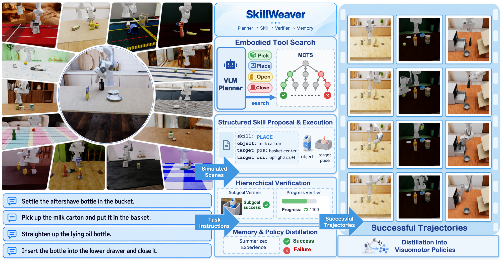
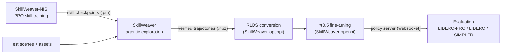

<div align="center">

# SkillWeaver

### Agentic Exploration over Neural Interaction Skills for Scalable Robot Data Generation

**CoRL 2026**

[He Zhu](https://ada4321.github.io/)<sup>1</sup>,
[Lusen Zhao](https://forestontheland.github.io/cv/)<sup>2&dagger;</sup>,
Kwan Man Cheng<sup>1</sup>,
Su Li<sup>1</sup>,
[Katerina Fragkiadaki](https://www.cs.cmu.edu/~katef/)<sup>1</sup>

<sup>1</sup>Carnegie Mellon University &nbsp;&nbsp; <sup>2</sup>University of Illinois Urbana-Champaign<br>
<sup>&dagger;</sup>Work done during an internship at Carnegie Mellon University

[**Project Page**](https://katefgroup.github.io/skillweaver/) &nbsp;|&nbsp;
[**arXiv**](https://arxiv.org/abs/2609.36171) &nbsp;|&nbsp;
[**Paper**](https://arxiv.org/pdf/2609.36171)

</div>

<p align="center">
  
</p>

SkillWeaver is an agentic framework that generates robot training data in simulation.
Given a simulated scene and a potentially long-horizon robot manipulation task, a VLM agent explores the task by invoking **Neural Interaction Skills (NIS)**: reusable,
parameterized, closed-loop RL policies for contact-rich interaction (Pick, Place, Open, Close).
The agent's attempts are organized as a **verifier-guided Monte Carlo tree search**. A
hierarchical VLM verifier scores each skill outcome and writes reflections on failures, and an
**experience memory** carries lessons across search episodes. Verified trajectories are exported as
multimodal demonstrations and distilled into visuomotor policies (π0.5), which we evaluate on
LIBERO-PRO, LIBERO, SIMPLER-WidowX and a real Franka robot.

## News

- **2026-10**: Released [SkillWeaver-openpi](https://github.com/Ada4321/SkillWeaver-openpi): conversion of SkillWeaver trajectories to RLDS and π0.5
  fine-tuning, with the LIBERO-Object training data on [Hugging Face](https://huggingface.co/datasets/Ada-4321/SkillWeaver-RLDS).
- **2026-10**: Released [SkillWeaver-NIS](https://github.com/Ada4321/SkillWeaver-NIS): Isaac Lab training
  environments for the Neural Interaction Skills (11 Franka sub-policies and WidowX Pick), with their checkpoints
  and example assets on [Hugging Face](https://huggingface.co/datasets/Ada-4321/SkillWeaver-NIS).

## Release status

- [x] **Neural Interaction Skills**: PPO training of Pick / Place / Open / Close in Isaac Lab ([code](https://github.com/Ada4321/SkillWeaver-NIS), [checkpoints and assets](https://huggingface.co/datasets/Ada-4321/SkillWeaver-NIS))
- [ ] **Agentic exploration**: VLM planner, MCTS, hierarchical verifier, experience memory, trajectory export (coming soon)
- [ ] **Test data**: a small set of scenes, assets and NIS checkpoints to run the pipeline end to end (coming soon)
- [x] **Policy training**: trajectory to RLDS conversion, π0.5 fine-tuning configs ([code](https://github.com/Ada4321/SkillWeaver-openpi), [data](https://huggingface.co/datasets/Ada-4321/SkillWeaver-RLDS))
- [ ] **Benchmark evaluation**: LIBERO-PRO, LIBERO, SIMPLER-WidowX clients (coming soon)

The asset and scene generation pipeline, real-to-sim scene reconstruction and real-robot
deployment code are not part of this release.

## Getting the code

[SkillWeaver-NIS](https://github.com/Ada4321/SkillWeaver-NIS) and [SkillWeaver-openpi](https://github.com/Ada4321/SkillWeaver-openpi) are included as git
submodules, so clone with `--recursive`:

```bash
git clone --recursive https://github.com/Ada4321/SkillWeaver.git
```

In an existing clone, run `git submodule update --init --recursive`. Installation and usage of each component
are described in its own README.

## Code architecture



| Interface | Producer | Consumer |
|---|---|---|
| Skill checkpoints (`.pth`, rl_games) | [SkillWeaver-NIS](https://github.com/Ada4321/SkillWeaver-NIS) | SkillWeaver (closed-loop skill execution) |
| Trajectories (`traj/*.npz`): RGB, depth, segmentation, joint states and actions, object states, language | SkillWeaver | RLDS converter ([SkillWeaver-openpi](https://github.com/Ada4321/SkillWeaver-openpi)) |
| RLDS dataset | RLDS converter | π0.5 training ([SkillWeaver-openpi](https://github.com/Ada4321/SkillWeaver-openpi)) |
| Policy server (websocket) | openpi `serve_policy.py` | benchmark clients |

## Citation

```bibtex
@misc{zhu2026skillweaveragenticexplorationneural,
      title={SkillWeaver: Agentic Exploration over Neural Interaction Skills for Scalable Robot Data Generation},
      author={He Zhu and Lusen Zhao and Kwan Man Cheng and Su Li and Katerina Fragkiadaki},
      year={2026},
      eprint={2609.36171},
      archivePrefix={arXiv},
      primaryClass={cs.RO},
      url={https://arxiv.org/abs/2609.36171},
}
```
